# 🩺 Medical Report Explainer

> **Understand your lab report in plain language — directly in your browser.**

Medical Report Explainer is a privacy-focused React web application that helps users understand common laboratory test results.

Users can upload a **text-based PDF medical report**, and the application extracts supported test values, compares them with reference ranges, identifies results that are **Normal, High, or Low**, highlights results that may need attention, and explains the tests in simple language.

The PDF is processed **inside the user's browser** and is not uploaded to a server.

---

## 📌 Table of Contents

- [Overview](#-overview)
- [Problem Statement](#-problem-statement)
- [Our Solution](#-our-solution)
- [How It Works](#-how-it-works)
- [System Architecture](#-system-architecture)
- [PDF Processing Flow](#-pdf-processing-flow)
- [Result Analysis Flow](#-result-analysis-flow)
- [Attention Detection](#-attention-detection)
- [Features](#-features)
- [Tech Stack](#-tech-stack)
- [Project Structure](#-project-structure)
- [Getting Started](#-getting-started)
- [Privacy](#-privacy)
- [Limitations](#-limitations)
- [Future Improvements](#-future-improvements)
- [Disclaimer](#-disclaimer)

---

# 🔍 Overview

Medical reports often contain technical terms, numerical values, and reference ranges that can be difficult to understand.

**Medical Report Explainer** converts supported lab-report data into a simpler format so that users can quickly see:

- What tests were detected
- Their measured values
- Their normal/reference ranges
- Whether each result is **Normal, High, or Low**
- Which results are significantly outside the reference range
- What each test means
- Possible general reasons for high or low values
- Questions users may want to discuss with their doctor

---

# ❗ Problem Statement

A typical lab report may look like this:

```text
Hemoglobin       10.2 g/dL      13.0 - 17.0
WBC Count        7500 cells/uL  4000 - 11000
Fasting Glucose  120 mg/dL      70 - 99
```

While the numbers are available, many users may not immediately understand:

```text
What does Hemoglobin measure?
        ↓
Is 10.2 normal?
        ↓
How far is it outside the reference range?
        ↓
What could a low value generally be associated with?
        ↓
What should I ask my doctor?
```

Medical Report Explainer makes this information easier to read and understand.

---

# 💡 Our Solution

The application follows a simple workflow:

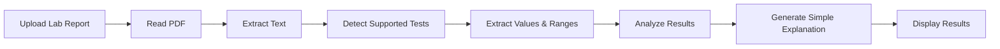

Everything happens directly inside the browser.

---

# ⚙️ How It Works

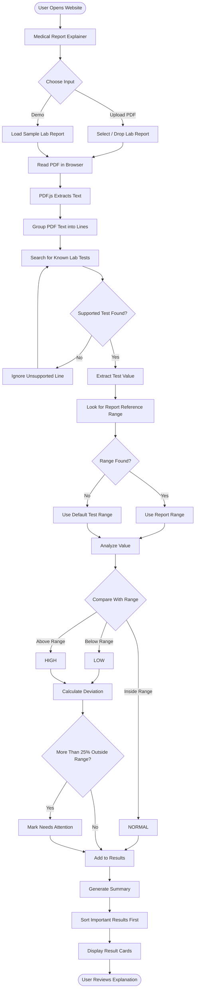

---

# 🏗️ System Architecture

The project uses a completely client-side architecture.

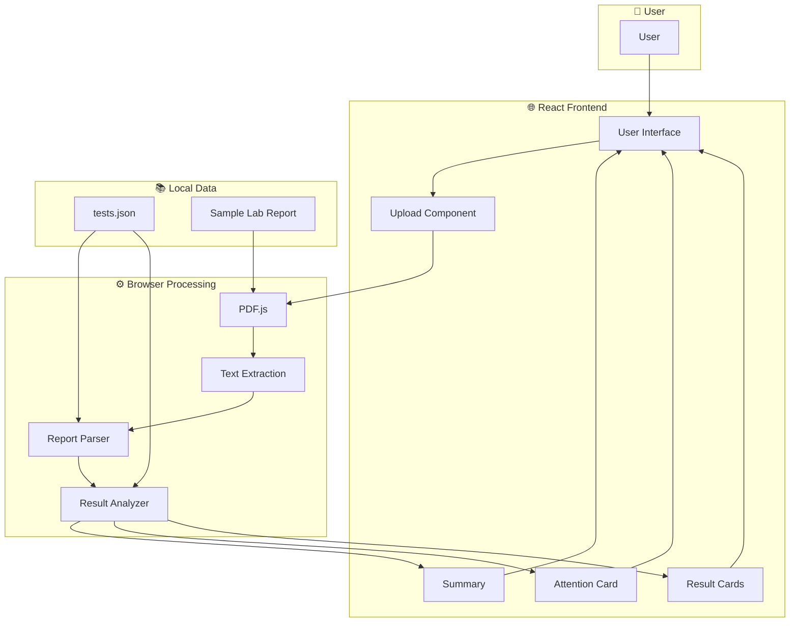

### Why this architecture?

The medical report does not need to be sent to a backend server.

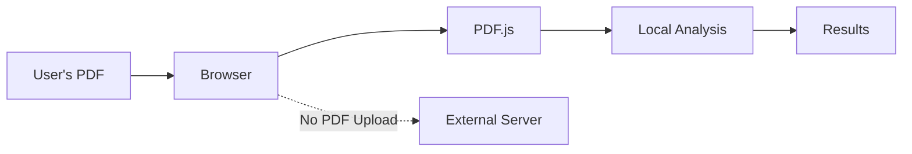

This helps keep report processing local to the user's device.

---

# 📄 PDF Processing Flow

The application uses **PDF.js (`pdfjs-dist`)** to read text from PDF files.

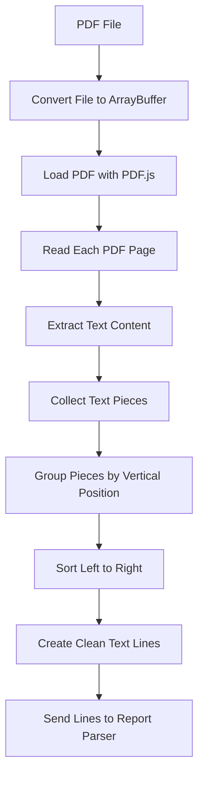

The extracted text is reorganized into readable lines before being passed to the parser.

---

# 🔎 Test Detection & Parsing

Supported tests and their information are stored in:

```text
src/data/tests.json
```

Each test can contain:

```text
Test Name
│
├── Aliases
├── Unit
├── Default Minimum Value
├── Default Maximum Value
├── Simple Explanation
├── Possible Reasons for Low Value
├── Possible Reasons for High Value
└── Questions to Ask a Doctor
```

For example, a test can be detected using different aliases.

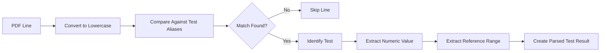

The parser also prevents the same supported test from being added multiple times.

---

# 📊 Result Analysis Flow

After a test has been detected, its value is compared with its reference range.

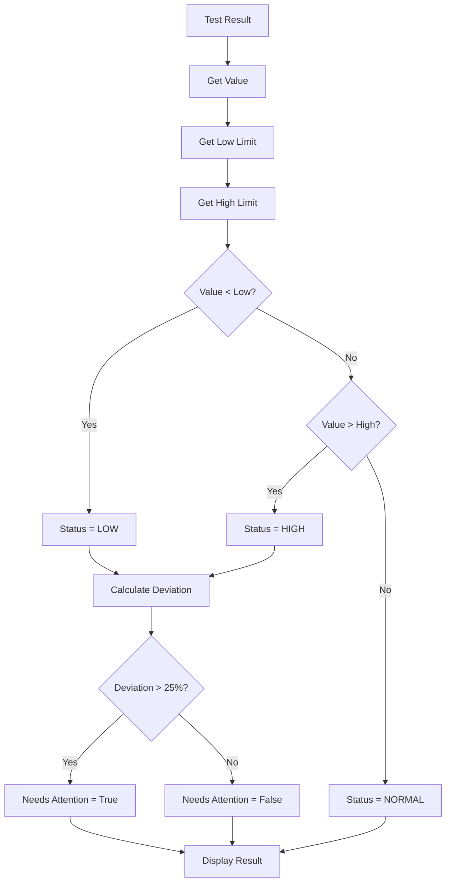

### Status Logic

```text
Value < Lower Limit  → LOW

Lower Limit ≤ Value ≤ Upper Limit  → NORMAL

Value > Upper Limit  → HIGH
```

---

# 🚨 Attention Detection

The application calculates how far an abnormal result is outside its selected reference range.

For a high result:

```text
Deviation = ((Value - High Limit) / High Limit) × 100
```

For a low result:

```text
Deviation = ((Low Limit - Value) / Low Limit) × 100
```

The current application rule marks a result as needing attention when:

```text
Deviation > 25%
```

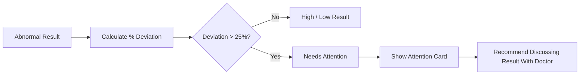

> **Important:** The 25% threshold is an application rule for highlighting results. It is **not a medical diagnosis or universal clinical urgency threshold**.

---

# 🧾 Reference Range Selection

Whenever possible, the application prefers the reference range written directly in the uploaded report.

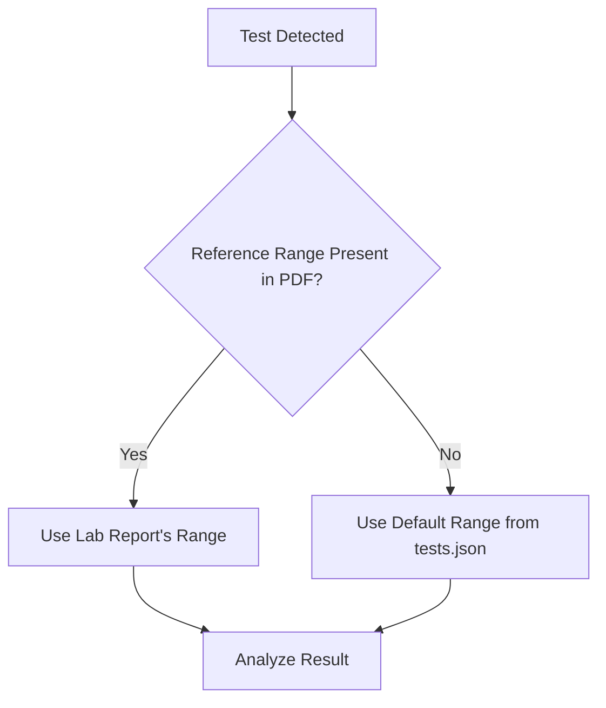

This is useful because laboratory reference ranges can differ.

---

# 📋 Result Display Flow

After analysis, the application prepares the information for the user.

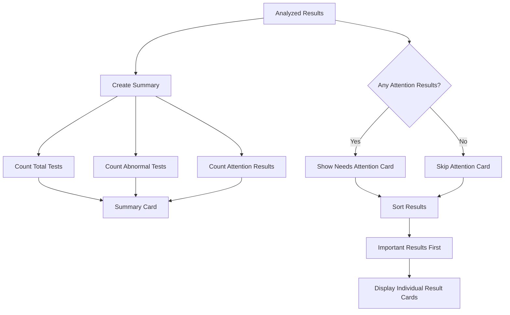

---

# 🧠 Detailed Result Explanation

Users can click a result to expand it.

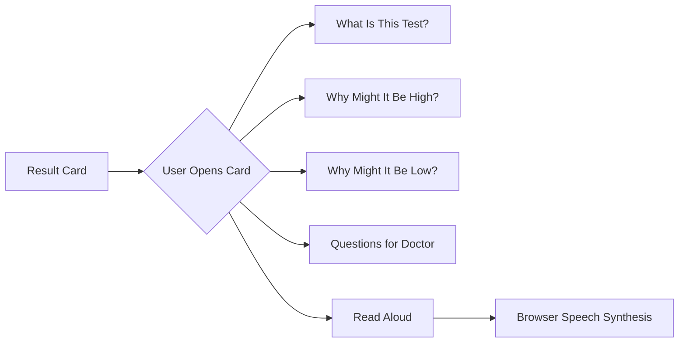

Normal results show the basic test explanation, while abnormal results can provide additional contextual information and questions to discuss with a healthcare professional.

---

# 🔊 Read Aloud Feature

The application includes browser-based text-to-speech.

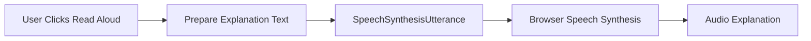

This can improve accessibility and make the report explanation easier to consume.

---

# ✨ Features

### 📤 PDF Upload

Users can:

- Click to select a PDF
- Drag and drop a PDF
- Use the included sample lab report

### 🔒 Browser-Side Processing

The report is processed locally in the browser by the application.

### 🔍 Automatic Test Detection

The parser searches extracted PDF text for supported test names and aliases.

### 📊 Automatic Classification

Results are automatically classified as:

```text
🟢 NORMAL
🟡 LOW
🔴 HIGH
```

### 🚨 Attention Highlighting

Results significantly outside the selected reference range can be highlighted separately.

### 📈 Report Summary

The application displays:

```text
Total Tests Found
        +
Tests Outside Normal Range
        +
Tests Marked as Needing Attention
```

### 📖 Plain-Language Explanations

Each supported test contains easy-to-understand information.

### 🗣️ Read Aloud

Users can listen to test explanations using the browser's Speech Synthesis API.

### 🧪 Sample Report

A sample PDF is included so users can test the application without uploading their own report.

### 📱 Responsive Interface

The application is designed to work across different screen sizes.

---

# 🛠️ Tech Stack

| Technology | Purpose |
|---|---|
| **React 19** | Frontend user interface |
| **JavaScript** | Application logic |
| **Vite** | Development and build tooling |
| **PDF.js / pdfjs-dist** | PDF text extraction |
| **CSS** | Styling and responsive UI |
| **Web Speech API** | Read-aloud functionality |
| **JSON** | Supported lab-test knowledge data |

---

# 🧩 Application Component Flow

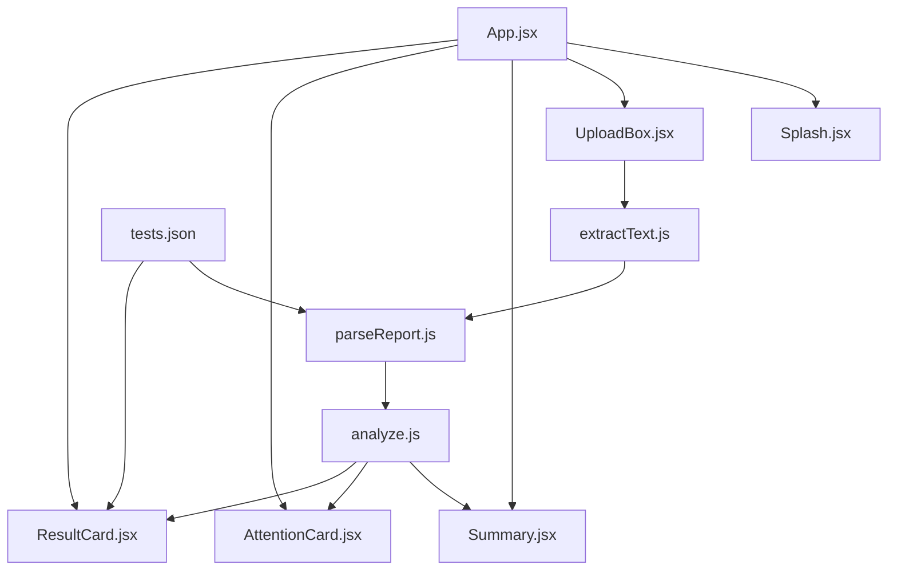

---

# 📂 Project Structure

```text
medreport/
│
├── public/
│   └── sample_lab_report.pdf
│
├── src/
│   │
│   ├── components/
│   │   ├── AttentionCard.jsx
│   │   ├── ResultCard.jsx
│   │   ├── Splash.jsx
│   │   ├── Summary.jsx
│   │   └── UploadBox.jsx
│   │
│   ├── data/
│   │   └── tests.json
│   │
│   ├── utils/
│   │   ├── analyze.js
│   │   ├── extractText.js
│   │   └── parseReport.js
│   │
│   ├── App.jsx
│   ├── App.css
│   ├── index.css
│   └── main.jsx
│
├── index.html
├── package.json
├── package-lock.json
├── vite.config.js
└── README.md
```

---

# 🔄 Complete Data Flow

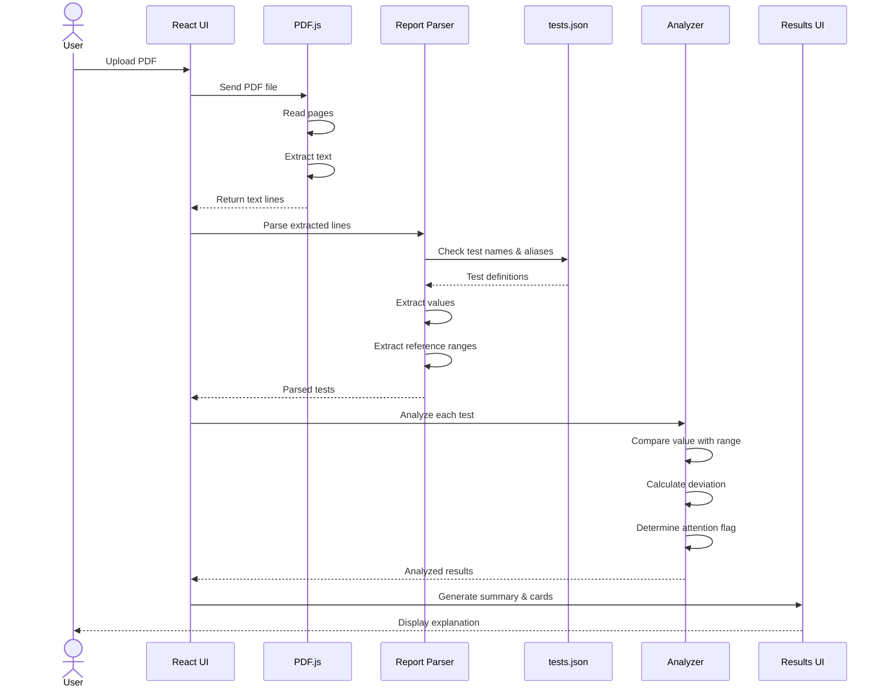

---

# 🚀 Getting Started

## 1. Clone the repository

```bash
git clone YOUR_REPOSITORY_URL
```

## 2. Open the project

```bash
cd medreport
```

## 3. Install dependencies

```bash
npm install
```

## 4. Start the development server

```bash
npm run dev
```

Vite will display the local development URL in your terminal.

Open that URL in your browser.

---

# 🏭 Production Build

Create a production build using:

```bash
npm run build
```

Preview the production build locally with:

```bash
npm run preview
```

---

# 🔐 Privacy

Privacy is an important part of the project's design.

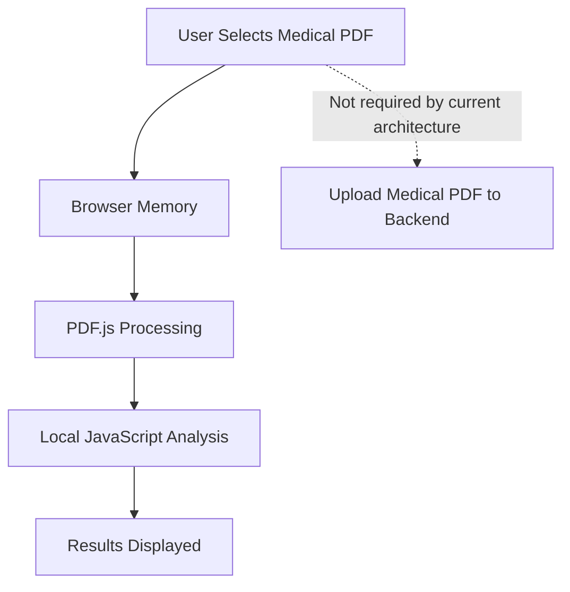

The current application processes the selected PDF in the browser and does not implement a backend upload for the report.

This provides a simple privacy-focused architecture.

---

# ⚠️ Error Handling

The application handles cases where the report cannot be processed.

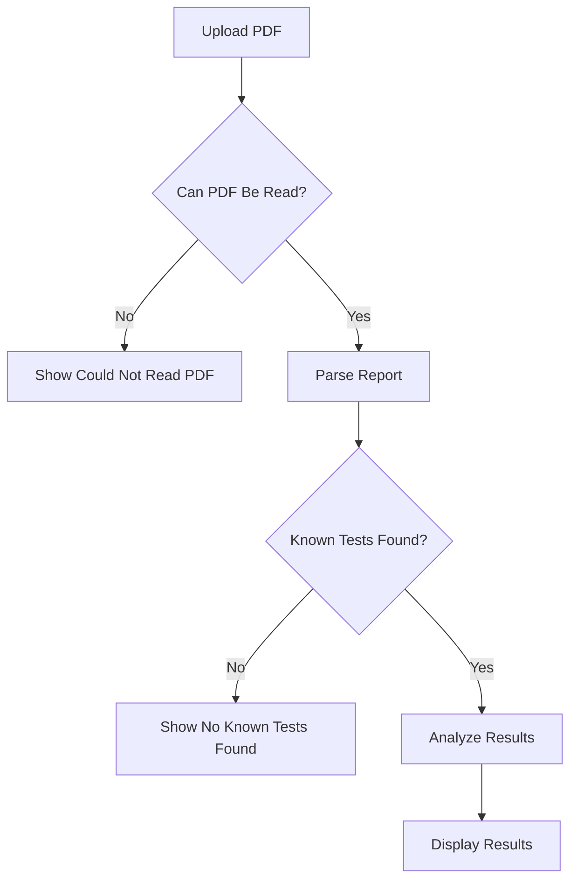

Currently, the parser is designed primarily for **text-based PDFs**.

---

# 🚧 Limitations

The current version has several important limitations:

- Scanned/image-only reports are not supported because OCR is not currently implemented.
- Only tests defined in `tests.json` can be recognized.
- Different laboratories can use different report formats.
- Test aliases and formatting can affect detection.
- Default reference ranges are only fallbacks when a report-specific range cannot be detected.
- Medical interpretation is intentionally limited.
- The **25% attention threshold is an application-defined highlighting rule**, not a clinical standard.
- The application should not be used for diagnosis.

---

# 🔮 Future Improvements

Future versions could include:

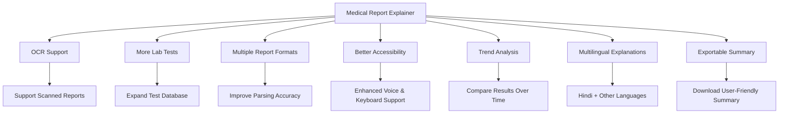

Possible future features include:

- 📷 OCR for scanned medical reports
- 🧪 Support for more laboratory tests
- 📊 Historical report comparison
- 📈 Health-result trend visualization
- 🌐 Multilingual explanations
- ♿ Additional accessibility improvements
- 📄 Exportable report summaries
- 🔎 Improved PDF parsing
- 📱 Progressive Web App support

---

# 🎯 Project Goal

The goal of Medical Report Explainer is not to replace healthcare professionals.

Instead, it aims to bridge the gap between:

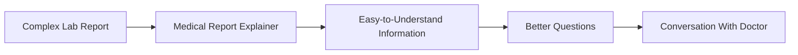

---

# ⚕️ Medical Disclaimer

> **Medical Report Explainer is an educational project and does not provide medical diagnosis, treatment recommendations, or professional medical advice.**

The explanations provided by the application are general educational information.

Reference ranges can vary depending on the laboratory, testing method, age, sex, medical history, medications, and other factors.

Results marked **High**, **Low**, or **Needs Attention** should not be interpreted as a diagnosis or emergency assessment.

Always consult a qualified healthcare professional for interpretation of laboratory results and medical decisions.

---

# 🤝 Contributing

Contributions are welcome.

You can contribute by:

- Adding support for more lab tests
- Improving report parsing
- Improving accessibility
- Fixing bugs
- Improving UI/UX
- Adding tests
- Improving documentation

Typical workflow:

```bash
git checkout -b feature/my-feature
git add .
git commit -m "Add my feature"
git push origin feature/my-feature
```

Then open a Pull Request.

---

# ⭐ Support

If you find this project useful, consider giving the repository a **⭐ star**.

---

<div align="center">

## 🩺 Medical Report Explainer

**Making laboratory reports easier to understand.**

Built with React • Vite • PDF.js • JavaScript

**Educational use only — not medical advice.**

</div>