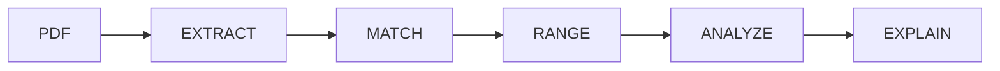
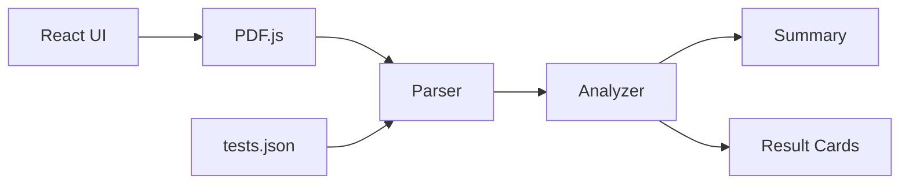
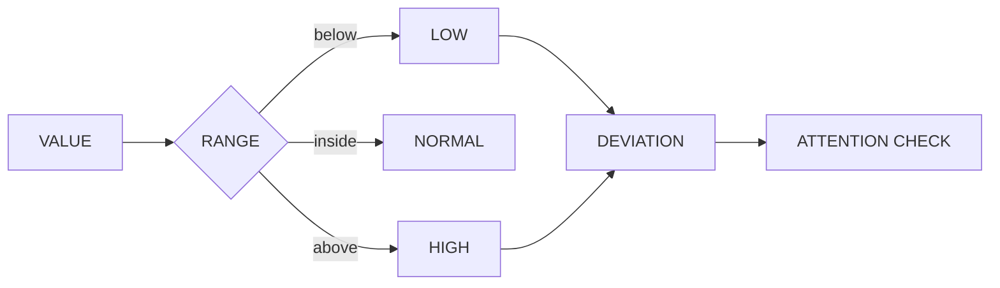

# MedReport_

**Your lab report shouldn't need a medical degree to understand.**

MedReport turns text-based laboratory PDFs into structured, human-readable insights — entirely inside your browser.

```text
INPUT                     ENGINE                     OUTPUT

lab-report.pdf     →      PDF extraction      →      12 tests detected
                           ↓                          9 normal
                           Test matching              2 high
                           ↓                          1 low
                           Range analysis             1 needs attention
```

`LOCAL PROCESSING` · `NO BACKEND UPLOAD` · `PRIVACY FIRST`

---

## 01 / THE IDEA

Lab reports contain the information you need, but not always in a form that's easy to understand.

MedReport converts this:

```text
Hemoglobin        10.2 g/dL        13.0 - 17.0
Fasting Glucose   120 mg/dL        70 - 99
WBC Count         7500 cells/uL    4000 - 11000
```

into this:

| TEST | RESULT | STATUS |
|---|---:|---|
| Hemoglobin | `10.2 g/dL` | ↓ LOW |
| Fasting Glucose | `120 mg/dL` | ↑ HIGH |
| WBC Count | `7500 cells/uL` | ✓ NORMAL |

Along with plain-language explanations of what each supported test means.

---

## 02 / PIPELINE



**PDF.js** extracts text → the parser matches known tests → values are compared against reference ranges → results are classified → React presents the explanation.

---

## 03 / WHAT IT DOES

```text
┌─────────────────────────────────────────────────────────────┐
│                                                             │
│   PDF EXTRACTION       Parse text-based medical reports     │
│   TEST DETECTION       Match supported tests + aliases      │
│   RANGE ANALYSIS       Detect low / normal / high values    │
│   ATTENTION SYSTEM     Surface significantly abnormal data  │
│   EXPLANATIONS         Explain tests in simple language     │
│   READ ALOUD           Browser-based speech synthesis       │
│   LOCAL PROCESSING     Keep report processing on-device     │
│                                                             │
└─────────────────────────────────────────────────────────────┘
```

---

## 04 / UNDER THE HOOD



| Layer | Technology |
|---|---|
| Interface | React 19 + CSS |
| Build | Vite |
| PDF Engine | PDF.js |
| Logic | JavaScript |
| Test Knowledge | JSON |
| Voice | Web Speech API |

No backend is required for the current report-processing pipeline.

---

## 05 / DECISION ENGINE



When an abnormal value is more than **25% outside the selected reference range**, MedReport flags it for additional attention.

> This threshold is a product highlighting rule — not a clinical urgency threshold.

---

## 06 / RUN IT

```bash
git clone YOUR_REPOSITORY_URL
cd MedReport
npm install
npm run dev
```

---

## 07 / NEXT

```text
[ ] OCR for scanned reports
[ ] Larger test database
[ ] Report-to-report comparison
[ ] Health trend visualization
[ ] Multilingual explanations
```

---

## IMPORTANT

MedReport is an **educational tool**, not a diagnostic system.

Reference ranges and medical interpretation depend on many factors. Results should always be discussed with a qualified healthcare professional when medical guidance is required.

---

**MedReport** / React · PDF.js · JavaScript

*Making medical reports readable.*
